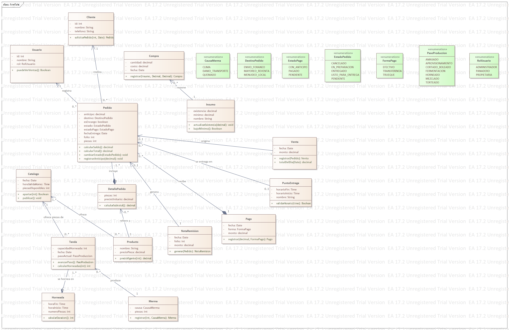

# Modelo de clases de análisis
**Libreta Raíz digital · Módulo de gestión de pedidos, producción y comercialización de panadería · Open Hub Tec**  
*Equipo ALQF · Fundamentos de Ingeniería de Software (SCC-1007), Unidad 4*

---

## Datos Generales
- **Institución:** Tecnológico Nacional de México / Instituto Tecnológico de Tlaxiaco
- **Carrera:** Ingeniería en Sistemas Computacionales
- **Docente:** Ing. José Alfredo Román Cruz
- **Producto:** Reporte de práctica 8
- **Lugar y fecha:** Tlaxiaco, Oax., noviembre de 2026
- **Presenta:**
  - Fidel Jimenez Sanchez
  - Quetzalli García García
  - Alyn Ximena Gómez Hernández
  - Ximena Leidaly González Morales

---

## 1. Introducción
Este reporte documenta el modelo de clases de análisis del módulo de gestión de pedidos, producción y comercialización de panadería del Open Hub Tec, desarrollado para la Panadería “Burritos” de Tlaxiaco, Oaxaca. El modelo traduce los requisitos del Documento de Especificación de Requisitos de Software (DRS v0.3) y los procesos del modelo BPMN de la Unidad 2 en clases, atributos, operaciones y relaciones, y es la base para el diseño posterior.

El modelo se elaboró en Enterprise Architect 17.2, dentro del paquete `Analisis` del archivo `modeloOpenHub-EquipoALQF.qea`. Contiene 15 clases, 7 enumeraciones, 13 asociaciones (3 de ellas composiciones), 46 atributos y 22 operaciones.

## 2. Objetivo
Representar con UML el vocabulario del negocio y las reglas que el sistema debe respetar, de modo que cada elemento del modelo se pueda rastrear hasta un requisito del DRS y un elemento del BPMN.

## 3. Método seguido
- Se leyeron los requisitos funcionales (RF-01 a RF-29), las reglas de negocio (RN-01 a RN-11) y los requisitos no funcionales (RNF-01 a RNF-16) del DRS, junto con los siete procesos BPMN de referencia (PR-01 a PR-07).
- Los sustantivos recurrentes en los requisitos y los objetos de datos del BPMN se tomaron como clases candidatas. Se descartaron los conceptos de interfaz (pantallas, avisos) y los externos al alcance, como facturación y contador.
- Los conjuntos de valores cerrados (estados, formas de pago, pasos de producción, causas de merma, roles y destinos) se modelaron como enumeraciones.
- Los atributos salieron de los datos que piden los criterios de aceptación; las operaciones, de los verbos de los requisitos (calcular, registrar, validar, avanzar).
- Las asociaciones se nombraron con un verbo y se les asignó multiplicidad según las reglas de negocio. A cada clase y enumeración se le agregó una nota de trazabilidad con sus RF, RN, RNF, PR y elementos BPMN.

## 4. Diagrama de clases de análisis
  
*Figura 1. Diagrama de clases del paquete Analisis (Enterprise Architect).*

## 5. Clases identificadas desde el DRS
La tabla resume la responsabilidad de cada clase y el proceso BPMN al que pertenece. Los requisitos exactos de cada una están en la sección 12.

| Clase | Responsabilidad | Proceso BPMN |
| :--- | :--- | :--- |
| **Pedido** | Solicitud de pan de un cliente, con fecha de entrega, anticipo, estado, estado de pago y destino. Es la clase central del módulo. | PR-01, PR-05 |
| **DetallePedido** | Línea de un pedido: producto, piezas y precio unitario vigente al registrarlo. | PR-01, PR-05 |
| **Producto** | Variedad de pan que se vende (por ejemplo cemita) con su precio por pieza; admite precio de mayoreo. | PR-01, PR-07 |
| **Cliente** | Persona u organización que solicita pedidos (pool Cliente del BPMN). | PR-01, PR-07 |
| **Usuario** | Persona que opera el sistema, con un rol que define sus permisos (propietaria, panadero, administrador). | PR-05 |
| **Pago** | Cobro aplicado a un pedido (anticipo o liquidación) con monto, forma de pago y fecha. | PR-05 |
| **NotaRemision** | Comprobante de entrega con folio consecutivo, que desglosa subtotal, anticipo y saldo. | PR-04, PR-05 |
| **Venta** | Registro de una venta del día originada por un pedido; permite el cierre diario. | PR-05 |
| **PuntoEntrega** | Lugar de recolección o entrega dentro de Tlaxiaco, con su horario de atención. | PR-04, PR-07 |
| **Catalogo** | Oferta publicada del día: piezas disponibles, hora de salida del horno y reserva de piezas. | PR-07, PR-03 |
| **Tanda** | Lote de producción de un día que avanza por los siete pasos y tiene una capacidad de horneada. | PR-03 |
| **Horneada** | Cada salida del horno de una tanda, con número de piezas, hora de inicio y hora de fin. | PR-03 |
| **Merma** | Pérdida de piezas con su causa (clima, quemado, daño en transporte). | PR-06 |
| **Compra** | Adquisición de un insumo con cantidad, costo y fecha. | PR-02 |
| **Insumo** | Materia prima (harina, panela, levadura, leña) con existencia y mínimo configurable. | PR-02 |

## 6. Atributos y tipos de datos
Todos los atributos tienen tipo explícito. Los tipos primitivos son `int`, `decimal`, `boolean`, `String`, `Date` y `Time`; los estados y causas usan enumeraciones.

| Clase | Atributos (nombre: tipo) |
| :--- | :--- |
| **Pedido** | `folio: int`; `fechaEntrega: Date`; `piezas: int`; `estadoPago: EstadoPago`; `estado: EstadoPedido`; `destino: DestinoPedido`; `anticipo: decimal`; `esEncargo: boolean` |
| **DetallePedido** | `piezas: int`; `precioUnitario: decimal` |
| **Producto** | `nombre: String`; `precioPieza: decimal` |
| **Cliente** | `id: int`; `nombre: String`; `telefono: String` |
| **Usuario** | `id: int`; `nombre: String`; `rol: RolUsuario` |
| **Pago** | `monto: decimal`; `forma: FormaPago`; `fecha: Date` |
| **NotaRemision** | `folio: int`; `fecha: Date`; `monto: decimal` |
| **Venta** | `fecha: Date`; `monto: decimal` |
| **PuntoEntrega** | `nombre: String`; `horarioInicio: Time`; `horarioFin: Time` |
| **Catalogo** | `fecha: Date`; `horaSalidaHorno: Time`; `piezasDisponibles: int` |
| **Tanda** | `fecha: Date`; `pasoActual: PasoProduccion`; `capacidadHorneada: int` |
| **Horneada** | `numeroPiezas: int`; `horaInicio: Time`; `horaFin: Time` |
| **Merma** | `piezas: int`; `causa: CausaMerma` |
| **Compra** | `fecha: Date`; `cantidad: decimal`; `costo: decimal` |
| **Insumo** | `nombre: String`; `existencia: decimal`; `minimo: decimal` |

## 7. Operaciones ligadas a los requisitos
Cada operación corresponde a un verbo de un requisito. La columna final indica el requisito que la justifica.

| Clase | Operación | Qué hace | Requisitos |
| :--- | :--- | :--- | :--- |
| **Pedido** | `registrarAnticipo(monto: decimal): void` | Guarda el anticipo y actualiza el estado de pago. | RF-02, RF-03 |
| **Pedido** | `calcularTotal(): decimal` | Suma los subtotales de los detalles. | RF-06 |
| **Pedido** | `calcularSaldo(): decimal` | Total menos anticipo. | RF-03, RN-02 |
| **Pedido** | `cambiarEstado(nuevo: EstadoPedido): void` | Cambia el estado del pedido y conserva el historial. | RF-05, RF-27 |
| **DetallePedido** | `calcularSubtotal(): decimal` | Piezas por precio unitario. | RF-06, RF-25 |
| **Producto** | `precioVigente(piezas: int): decimal` | Precio por pieza según la cantidad (menudeo o mayoreo). | RF-06, RN-01 |
| **Cliente** | `solicitarPedido(piezas: int, fechaEntrega: Date): Pedido` | Crea un pedido a partir de las piezas y la fecha de entrega. | RF-01, RF-18 |
| **Usuario** | `puedeVerVentas(): Boolean` | Indica si el rol permite ver ventas y cuentas. | RNF-04, RN-05 |
| **Pago** | `registrar(monto: decimal, forma: FormaPago): Pago` | Registra un pago con su monto y forma. | RF-02, RF-03, RN-07 |
| **NotaRemision** | `generar(pedido: Pedido): NotaRemision` | Emite la nota con folio consecutivo para un pedido entregado. | RF-08 |
| **Venta** | `registrar(pedido: Pedido): Venta` | Registra la venta originada por un pedido. | RF-07 |
| **Venta** | `totalDelDia(dia: Date): decimal` | Suma las ventas de un día para el cierre. | RF-07, RF-29 |
| **PuntoEntrega** | `validarHorario(hora: time): Boolean` | Verifica que la hora esté en el horario de atención. | RF-24, RN-10 |
| **Catalogo** | `publicar(): void` | Publica el catálogo del día para el comprador. | RF-17 |
| **Catalogo** | `apartar(piezas: int): Boolean` | Aparta piezas sin exceder las disponibles. | RF-23, RNF-11 |
| **Tanda** | `avanzarPaso(): PasoProduccion` | Avanza al siguiente paso sin saltar ninguno. | RF-09, RF-10, RN-03 |
| **Tanda** | `calcularHorneadas(piezasTotales: int): int` | Horneadas necesarias, con redondeo hacia arriba. | RF-11, RF-12 |
| **Horneada** | `calcularDuracion(): int` | Duración como hora fin menos hora inicio. | RF-13 |
| **Merma** | `registrar(piezas: int, causa: CausaMerma): Merma` | Registra piezas perdidas y su causa. | RF-14 |
| **Compra** | `registrar(insumo: Insumo, cantidad: Decimal, costo: Decimal): Compra` | Registra la compra y aumenta la existencia del insumo. | RF-15 |
| **Insumo** | `actualizarExistencia(cantidad: decimal): void` | Modifica la existencia del insumo. | RF-15 |
| **Insumo** | `bajoMinimo(): Boolean` | Indica si la existencia está por debajo del mínimo. | RF-16 |

## 8. Encapsulamiento y visibilidad
Los 46 atributos de las clases son privados (`–`) y las 22 operaciones son públicas (`+`). El estado de un objeto solo cambia mediante sus operaciones; por ejemplo, el anticipo de un pedido se modifica con `registrarAnticipo`, que impide un anticipo mayor que el total (RF-03), y el paso de una tanda solo cambia con `avanzarPaso`, que respeta el orden de RN-03. Los valores de las enumeraciones son públicos porque son constantes.

## 9. Enumeraciones

| Enumeración | Valores | Se usa en | Requisitos |
| :--- | :--- | :--- | :--- |
| **EstadoPedido** | `PENDIENTE`, `EN_PREPARACION`, `LISTO_PARA_ENTREGA`, `ENTREGADO`, `CANCELADO` | `Pedido.estado` | RF-05, RF-27 |
| **EstadoPago** | `PAGADO`, `CON_ANTICIPO`, `PENDIENTE` | `Pedido.estadoPago` | RF-02 |
| **FormaPago** | `EFECTIVO`, `TRUEQUE`, `TRANSFERENCIA` | `Pago.forma` | RF-02 |
| **DestinoPedido** | `MENUDEO_LOCAL`, `MAYOREO_REVENTA`, `ENVIO_FORANEO` | `Pedido.destino` | RF-01 |
| **PasoProduccion** | `APROVISIONAMIENTO`, `MEZCLADO`, `AMASADO`, `CORTADO_BOLEADO`, `TORTEADO`, `FERMENTACION`, `HORNEADO` | `Tanda.pasoActual` | RF-09, RF-10 |
| **CausaMerma** | `CLIMA`, `QUEMADO`, `DANIO_TRANSPORTE` | `Merma.causa` | RF-14 |
| **RolUsuario** | `PROPIETARIA`, `PANADERO`, `ADMINISTRADOR` | `Usuario.rol` | RNF-04 |

## 10. Asociaciones y multiplicidad
La multiplicidad de cada extremo indica con cuántos objetos de esa clase se relaciona un objeto de la clase del otro extremo. Por ejemplo, un cliente realiza `0..*` pedidos y un pedido pertenece a `1` cliente.

| Asociación | Clase A | Mult. A | Clase B | Mult. B | Significado |
| :--- | :--- | :--- | :--- | :--- | :--- |
| **realiza** | Cliente | 1 | Pedido | 0..* | Un cliente realiza cero o más pedidos. |
| **registra** | Usuario | 1 | Pedido | 0..* | Un usuario registra cero o más pedidos. |
| **incluye** | Pedido | 1 | DetallePedido | 1..* | Un pedido incluye al menos un detalle (composición). |
| **refiere a** | Producto | 1 | DetallePedido | 0..* | Cada detalle se refiere a un producto. |
| **recibe** | Pedido | 1 | Pago | 0..* | Un pedido recibe cero o más pagos (composición). |
| **origina** | Pedido | 1 | Venta | 0..1 | Un pedido entregado origina una venta. |
| **genera** | Pedido | 1 | NotaRemision | 0..1 | Un pedido entregado genera una nota de remisión. |
| **se entrega en** | PuntoEntrega | 0..1 | Pedido | 0..* | Un pedido puede entregarse en un punto; un punto recibe varios pedidos. |
| **ofrece** | Catalogo | 1..* | Producto | 0..* | Un catálogo ofrece productos del día; un producto aparece en uno o más catálogos. |
| **ofrece piezas de** | Catalogo | 1 | Tanda | 0..* | El catálogo publica piezas de las tandas del día. |
| **se hornea en** | Tanda | 1 | Horneada | 1..* | Una tanda se hornea en una o más horneadas (composición). |
| **produce** | Tanda | 1 | Merma | 0..* | Una tanda puede producir mermas. |
| **repone** | Insumo | 1 | Compra | 0..* | Un insumo se repone con cero o más compras. |

## 11. Agregación, composición y herencia
Se usó **composición** cuando la parte no existe sin el todo y se elimina con él:
- **Pedido y DetallePedido:** un detalle no tiene sentido fuera de su pedido.
- **Pedido y Pago:** los pagos forman parte del historial de cobro del pedido (RN-02, RN-07).
- **Tanda y Horneada:** cada horneada pertenece a una sola tanda.

No se usó **agregación** porque ninguna relación del modelo es de “contiene pero existe por separado”. Tampoco se usó **herencia**: `Cliente` y `Usuario` comparten `id` y `nombre`, pero tienen responsabilidades distintas (el cliente solicita pedidos y el usuario opera el sistema con un rol). No se modeló una clase `Persona`; puede evaluarse en el diseño, cuando se defina la autenticación.

## 12. Trazabilidad con el DRS y el BPMN
Cada clase y enumeración lleva su nota de trazabilidad en el campo *Notes* de Enterprise Architect. La tabla las reúne, con los elementos BPMN numerados (`#`) del DRS, sección 3.3.

| Elemento | RF / RNF | RN | Proceso | Elementos BPMN |
| :--- | :--- | :--- | :--- | :--- |
| **Pedido** | RF-01, RF-02, RF-03, RF-04, RF-05, RF-06, RF-18 | RN-02, RN-06, RN-08, RN-09 | PR-01, PR-05 | #1, #2, #3, #8, #16, #18, #19 |
| **DetallePedido** | RF-06, RF-25 | RN-01 | PR-01, PR-05 | #2, #17 |
| **Producto** | RF-06, RF-17 | RN-01 | PR-01, PR-07 | #2, #17 |
| **Cliente** | RF-01, RF-18, RNF-15 | — | PR-01, PR-07 | #1 (pool Cliente) |
| **Usuario** | RNF-04, RNF-09 | RN-05 | PR-05 | #17, #18 |
| **Pago** | RF-02, RF-03 | RN-02, RN-07, RN-11 | PR-05 | #16, #18 |
| **NotaRemision** | RF-08, RNF-07, RNF-16 | — | PR-04, PR-05 | #15c, #19 |
| **Venta** | RF-07, RF-29 | RN-05 | PR-05 | #17 |
| **PuntoEntrega** | RF-20, RF-24 | RN-10 | PR-04, PR-07 | #15b, #15c |
| **Catalogo** | RF-17, RF-23, RF-26, RNF-11 | — | PR-07, PR-03 | #14a (flujo hacia #1) |
| **Tanda** | RF-09, RF-10, RF-11, RF-12, RF-26 | RN-03, RN-04 | PR-03 | #8 a #14a |
| **Horneada** | RF-13 | RN-04 | PR-03 | #14a |
| **Merma** | RF-14 | — | PR-06 | #12x a #12z, #15x a #15y |
| **Compra** | RF-15 | — | PR-02 | #5, #6 |
| **Insumo** | RF-15, RF-16 | — | PR-02 | #6, #7 |
| **EstadoPedido** | RF-05, RF-27 | — | PR-01, PR-05 | #8, #19 |
| **EstadoPago** | RF-02 | — | PR-05 | #16, #18 |
| **FormaPago** | RF-02 | RN-07, RN-11 | PR-05 | #16 |
| **DestinoPedido** | RF-01 | RN-06 | PR-01, PR-04 | #3, #15b |
| **PasoProduccion** | RF-09, RF-10 | RN-03 | PR-03 | #10 a #14a |
| **CausaMerma** | RF-14 | — | PR-06 | #12x a #12z, #15x a #15y |
| **RolUsuario** | RNF-04 | RN-05 | PR-05 | #17, #18 |

### Del requisito al modelo

| Requisito | Resumen | Clases que lo respaldan |
| :--- | :--- | :--- |
| **RF-01** | Registrar pedido | Pedido, Cliente, DestinoPedido |
| **RF-02** | Estado de pago | Pedido, Pago, EstadoPago, FormaPago |
| **RF-03** | Anticipo y saldo | Pedido, Pago |
| **RF-04** | Lista de pendientes | Pedido |
| **RF-05** | Cambiar estado del pedido | Pedido, EstadoPedido |
| **RF-06** | Total del pedido | Pedido, DetallePedido, Producto |
| **RF-07** | Ventas y total diario | Venta |
| **RF-08** | Nota de remisión | NotaRemision |
| **RF-09** | Siete pasos de producción | Tanda, PasoProduccion |
| **RF-10** | Orden de los pasos | Tanda, PasoProduccion |
| **RF-11** | Capacidad por horneada | Tanda |
| **RF-12** | Cálculo de horneadas | Tanda |
| **RF-13** | Registro de horneadas | Horneada |
| **RF-14** | Mermas | Merma, CausaMerma |
| **RF-15** | Compras de insumos | Compra, Insumo |
| **RF-16** | Aviso de existencia baja | Insumo |
| **RF-17** | Catálogo del día | Producto, Catalogo |
| **RF-18** | Pedido en línea y encargos | Pedido, Cliente |
| **RF-19** | Confirmación al comprador | Sin clase (ver sección 15) |
| **RF-20** | Punto de entrega | PuntoEntrega |
| **RF-21** | Foto y comunidad del productor | Sin clase (ver sección 15) |
| **RF-22** | Origen artesanal | Sin clase (ver sección 15) |
| **RF-23** | Apartar piezas | Catalogo |
| **RF-24** | Horario de recolección | PuntoEntrega |
| **RF-25** | Desglose de costos | DetallePedido |
| **RF-26** | Aviso de pan caliente | Catalogo, Tanda |
| **RF-27** | Estado visible al comprador | EstadoPedido |
| **RF-28** | Reporte de incidencias | Sin clase (ver sección 15) |
| **RF-29** | Estadísticas de venta | Venta |

## 13. Notación UML y uso de Enterprise Architect
- El modelo está en el paquete `Analisis` del archivo `modeloOpenHub-EquipoALQF.qea`, con un solo diagrama de clases.
- Las enumeraciones usan el estereotipo `«enumeration»` y las clases muestran los compartimentos de atributos y operaciones.
- Los nombres de clases están en `PascalCase` y los de atributos y operaciones en `camelCase`, con el vocabulario de la organización (nota de remisión, pieza, panadero).
- Las asociaciones tienen nombre, multiplicidad y flecha de navegación; las composiciones usan rombo relleno.
- La trazabilidad se guarda en el campo *Notes* de cada elemento, con el formato `RF · RN · PR / #BPMN`.

## 14. Trabajo por pull request
El equipo trabaja en el repositorio `https://github.com/Fidel20-01/github-pieces` con las convenciones del DRS (sección 7.5): cada commit referencia su requisito con `“Refs #n”`, el que lo completa usa `“Closes #n”` y las ramas se nombran con el formato `rf-01-registrar-pedido`. Los cambios al modelo se integran mediante pull request revisado por otro integrante.

## 15. Revisión cruzada y mejoras
Al revisar el modelo contra el DRS se identificaron los siguientes puntos. Las correcciones de las filas 1 y 2 se aplican en Enterprise Architect y se actualiza la figura 1 antes de la entrega final.

| N.º | Hallazgo | Mejora | Estado |
| :--- | :--- | :--- | :--- |
| **1** | En `Pedido–DetallePedido`, `Pedido–Pago` y `Tanda–Horneada`, el rombo de composición está en el lado de la parte y debe estar en el todo (`Pedido` y `Tanda`). | Mover el rombo a `Pedido` y a `Tanda`. | Por aplicar |
| **2** | Las multiplicidades de *incluye*, *recibe*, *se hornea en*, *produce*, *genera* y *origina* están invertidas: por ejemplo, `Pago` muestra `1` y `Pedido` `0..*`. | `Pedido 1` con `DetallePedido 1..*`, `Pago 0..*`, `Venta 0..1` y `NotaRemision 0..1`; `Tanda 1` con `Horneada 1..*` y `Merma 0..*`. | Por aplicar |
| **3** | Los tipos no son uniformes: `decimal` y `Decimal`, `boolean` y `Boolean`, `Time` y `time`. | Usar `decimal`, `boolean` y `Time` en todo el modelo. | Por aplicar |
| **4** | `Pedido.piezas` y `Pedido.anticipo` pueden obtenerse de los detalles y de los pagos. | Decidir en diseño si se conservan como datos derivados. | Pendiente |
| **5** | RF-19, RF-21, RF-22 y RF-28 (confirmación, origen del producto y reporte de incidencias) no tienen clase. | Evaluar clases o atributos para la Fase 2. | Pendiente |
| **6** | El diagrama exportado muestra la marca de versión de prueba de Enterprise Architect y tiene líneas que se cruzan alrededor de `Pedido`. | Exportar con licencia y reubicar las clases. | Por aplicar |

## 16. Conclusiones
El modelo cubre las tres áreas del negocio, que son pedidos y cobro, producción e inventario, con 15 clases y 7 enumeraciones, y cada elemento se puede rastrear hasta el DRS y el BPMN. El encapsulamiento es consistente y las operaciones responden a verbos de los requisitos. Los puntos pendientes de la sección 15 son de forma (rombos, multiplicidades y tipos) y no cambian el alcance. Con ellos aplicados, el modelo queda listo como base para el diseño del sistema.

## 17. Referencias
- Equipo ALQF. *Documento de Especificación de Requisitos de Software (DRS) v0.3*, octubre de 2026.
- Equipo ALQF. *Reporte de BPMN, Unidad 2*.
- Archivo `modeloOpenHub-EquipoALQF.qea` y diagrama de clases (`diagrama-clases.png`).
- Repositorio del proyecto: `https://github.com/Fidel20-01/github-pieces`
- OMG. *Unified Modeling Language (UML) Specification*.