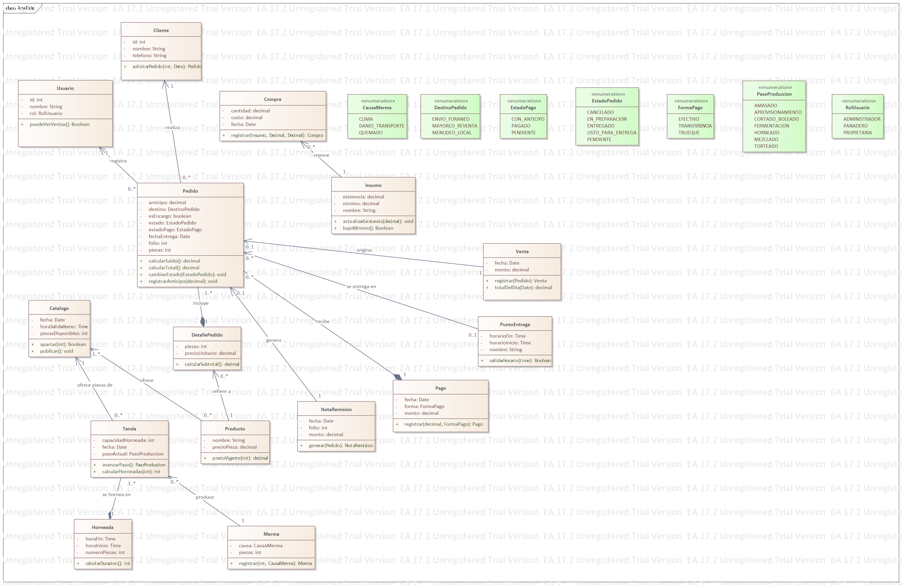

# Entrega · Práctica 9

**Equipo:** ALQF (Ximena, Alyn, Quetzalli, Fidel)
**Módulo del Hub:** Open Hub Tec (Gestión de Producción y Pedidos de Panadería)
**Organización:** Tecnológico Nacional de México - Campus Tlaxiaco

## 1. Clases identificadas

| Clase | Sustantivo del DRS | Requisito |
|---|---|---|
| Pedido | "el cliente realiza un pedido" | RF-01, RF-02 |
| Cliente | "registro de cliente" | RF-01 |
| Producto | "catálogo de productos" | RF-17 |
| Insumo | "control de insumos" | RF-06 |
| Venta | "registro de ventas diarias" | RF-07 |

## 2. Atributos y tipos

- Pedido: folio: int, piezas: int, anticipo: decimal, fechaEntrega: Date
- Cliente: id: int, nombre: String, telefono: String
- Producto: nombre: String, precioPieza: decimal
- Insumo: nombre: String, existencia: decimal, minimo: decimal
- Venta: fecha: Date, monto: decimal

## 3. Operaciones

- Pedido.calcularTotal(): decimal ← RF-03 "calcular costo total del pedido"
- Pedido.cambiarEstado(estado: EstadoPedido): void ← RF-04 "actualizar estado del pedido"
- Producto.precioVigente(id: int): decimal ← RF-17 "consultar precio vigente"
- Insumo.actualizarExistencia(cantidad: decimal): void ← RF-06 "actualizar inventario de insumos"
- Venta.registrar(pedido: Pedido): Venta ← RF-07 "registrar venta completada"

## 4. Encapsulamiento y visibilidad

Atributos definidos como privados (-) para proteger el estado de los objetos, y operaciones clave como públicas (+) para permitir la interacción entre clases de manera controlada según el diseño orientado a objetos.

## 5. Asociaciones y multiplicidad

- Un Cliente solicita 0..* Pedidos; cada Pedido pertenece a 1 Cliente.
- Un Pedido incluye 1..* DetallePedidos; cada DetallePedido se refiere a 1 Producto.
- Una Compra repone 1 Insumo; un Insumo es repuesto por 0..* Compras.

## 6. Agregación, composición y herencia

Se utilizó composición entre Pedido y DetallePedido debido a que los detalles no pueden existir de forma independiente sin el pedido que los agrupa. Se utilizaron enumeraciones para estandarizar catálogos fijos (como EstadoPedido y FormaPago).

## 7. Trazabilidad

| Clase | Requisito | Actividad del BPMN |
|---|---|---|
| Pedido | RF-01, RF-02, RF-03 | PR-01 / #1, #2, #3 |
| Producto | RF-17, RF-23 | PR-07 / #8, #16 |
| Venta | RF-07, RF-29 | PR-05 / #18, #19 |
| Insumo | RF-06, RF-25 | PR-01 / #8 |

## 8. Diagrama y notación UML

El modelo fuente de Enterprise Architect se encuentra en: `modelo/OpenHub-EquipoALQF.qea`

## 9. Trabajo en equipo

| Integrante | Pull requests que abrió | Pull requests que revisó |
|---|---|---|
| Fidel | #3 | #2 |
| Ximena | #1 | #3 |
| Alyn | #2 | #1 |
| Quetzalli | #4 | #2 |

## 10. Revisión cruzada

| Observación del equipo revisor | Qué hicimos |
|---|---|
| Revisar multiplicidades en las asociaciones de pedidos y detalles. | Corregido y validado directamente en el diagrama de Enterprise Architect. |
| Asegurar tipos estrictos en los parámetros de las operaciones. | Corregido agregando tipos de datos (`decimal`, `int`, `void`, `Boolean`) en todas las operaciones. |
